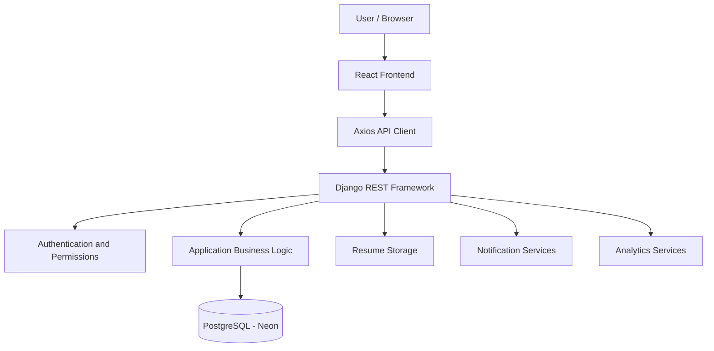
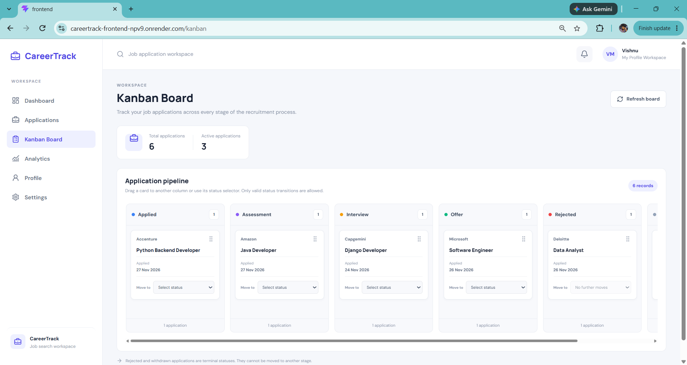

# CareerTrack — Job Application Management System

A full-stack job application tracking platform built with **Python, Django REST Framework, PostgreSQL, React, and JavaScript**. CareerTrack helps users organize job applications, track recruitment progress, manage resumes, monitor interview activity, and analyze their job search through a centralized dashboard.

**Live Demo:** [Frontend URL](https://careertrack-frontend-npv9.onrender.com)  
**Backend API:** [Backend URL](https://careertrack-backend-9gb6.onrender.com)  
**API Documentation:** [Swagger UI](https://careertrack-backend-9gb6.onrender.com/api/schema/swagger-ui/)  
**Repository:** [GitHub Repository](https://github.com/VishnuMavilla004/job-application-management-system)

---

## Table of Contents

- [Overview](#overview)
- [Features](#features)
- [Technology Stack](#technology-stack)
- [System Architecture](#system-architecture)
- [Application Modules](#application-modules)
- [API Capabilities](#api-capabilities)
- [Database Design](#database-design)
- [Project Structure](#project-structure)
- [Screenshots](#screenshots)
- [Local Installation](#local-installation)
- [Environment Configuration](#environment-configuration)
- [Running Tests](#running-tests)
- [Deployment](#deployment)
- [Security](#security)
- [Future Improvements](#future-improvements)
- [Author](#author)

---

## Overview

CareerTrack is designed to simplify the job search process by providing a single platform to manage job applications and recruitment activities.

Users can record applications, associate them with companies, update application statuses, maintain status history, organize applications using a Kanban board, upload resumes, and view analytics about their job search.

The application follows a REST API architecture, with a React frontend communicating with a Django REST Framework backend.

## Features

### Authentication and User Management
- User registration and login.
- JWT-based authentication.
- Access and refresh token handling.
- Logout and token invalidation.
- User profile management.
- Password management.
- User-level data isolation.

### Company Management
- Retrieve available companies.
- Create and manage company records through the API.
- Associate applications with companies.

### Job Application Management
- Create, view, update, and delete applications.
- Store company, job title, location, salary, application date, job URL, and other application details.
- Track recruitment status.
- Validate application data.
- Maintain application status history.
- Add and manage application notes.

### Search, Filtering, and Pagination
- Search applications.
- Filter by status, company, employment type, work mode, location, date, and salary.
- Combine multiple filters.
- Sort application records.
- Paginate results with configurable page sizes.

### Dashboard and Analytics
- Application summary and KPI cards.
- Application trends and status distribution.
- Recruitment funnel analytics.
- Company-level analytics.
- Date-range filtering and trend granularity.
- CSV analytics export.

### Kanban Board
- Visualize applications by recruitment status.
- Move applications between supported stages using drag and drop.
- Validate status transitions.
- Synchronize status changes with the backend.

### Resume Management
- Upload and manage resume documents.
- Validate supported file formats and file signatures.
- Set a default resume.
- Access resume documents through the configured storage integration.

### Notifications
- In-app notifications.
- Read and unread notification tracking.
- Mark individual notifications as read.
- Mark all notifications as read.
- Configurable email notification support.

---

## Technology Stack

| Layer | Technologies |
|---|---|
| Frontend | HTML5, CSS3, JavaScript ES6+, React |
| Frontend tooling | Vite, Axios, npm |
| Backend | Python, Django, Django REST Framework |
| API documentation | drf-spectacular, OpenAPI, Swagger UI |
| Database | PostgreSQL |
| Authentication | JWT |
| Testing | pytest, pytest-django, pytest-cov |
| Deployment | Render |
| Database hosting | Neon PostgreSQL |
| Version control | Git, GitHub |

---

## System Architecture



The React application communicates with the backend through authenticated REST API requests. Django REST Framework handles validation, permissions, business logic, and database operations. PostgreSQL stores application data, while resume documents use the configured persistent storage integration.

---

## Application Modules

| Module | Responsibility |
|---|---|
| Users | Authentication, profiles, and account management |
| Companies | Company records and application associations |
| Applications | Job application CRUD, filtering, and status management |
| Dashboard | Summary metrics, trends, and analytics |
| Documents | Resume upload, validation, and management |
| Interviews | Interview-related data |
| Notifications | In-app notifications and email integration |

---

## API Capabilities

The backend exposes versioned REST API endpoints under:

```text
/api/v1/
```

Key API capabilities include:

| Area | Capability |
|---|---|
| Authentication | Registration, login, refresh, logout, profile |
| Companies | Company listing and creation |
| Applications | CRUD, filtering, sorting, pagination |
| Application status | Status updates and history |
| Dashboard | Summary, trends, distribution |
| Analytics | Advanced analytics and CSV export |
| Notifications | Listing and read-status management |
| Resumes | Resume upload and management |

Interactive API documentation is available through the deployed Swagger UI.

---

## Database Design

The backend uses PostgreSQL and Django ORM.

Core domain entities include:

- User
- Company
- JobApplication
- ApplicationStatusHistory
- ApplicationNote
- Interview
- ResumeDocument
- ApplicationNotification

The application uses relational associations, database constraints, and user-scoped querysets to maintain data integrity and isolate user records.

---

## Project Structure

```text
job-application-management-system/
│
├── backend/
│   ├── apps/
│   │   ├── applications/
│   │   ├── companies/
│   │   ├── dashboard/
│   │   ├── documents/
│   │   ├── interviews/
│   │   └── users/
│   ├── config/
│   │   └── settings/
│   ├── build.sh
│   ├── manage.py
│   ├── requirements.txt
│   └── pytest.ini
│
├── docs/
│   ├── architecture.md
│   └── screenshots/
│
├── frontend/
│   ├── public/
│   ├── src/
│   │   ├── api/
│   │   ├── assets/
│   │   ├── components/
│   │   ├── context/
│   │   ├── layouts/
│   │   ├── pages/
│   │   ├── styles/
│   │   └── utils/
│   ├── package.json
│   └── vite.config.js
│
├── .gitignore
└── README.md
```

---

## Screenshots

Add genuine screenshots from the deployed application to `docs/screenshots/`.

| Screen | Screenshot |
|---|---|
| Dashboard | `dashboard.png` |
| Applications list | `applications.png` |
| Create application | `create-application.png` |
| Kanban board | `kanban.png` |
| Analytics | `analytics.png` |
| Profile and resume management | `profile-resumes.png` |
| API documentation | `swagger.png` |


### Dashboard


### Applications


### Kanban Board



---

### Analytics


---

## Local Installation

### Prerequisites

- Python 3.11+
- Node.js and npm
- PostgreSQL
- Git

### 1. Clone the repository

```bash
git clone YOUR_GITHUB_REPOSITORY_URL
cd job-application-management-system
```

### 2. Configure the backend

```bash
cd backend

python -m venv .venv
```

Activate the virtual environment.

**Windows:**

```powershell
.venv\Scripts\Activate.ps1
```

Install dependencies:

```bash
pip install -r requirements.txt
```

Create your backend environment file using the provided `.env.example` as a reference. Configure your local PostgreSQL database and required Django settings.

Run migrations:

```bash
python manage.py migrate
```

Create an administrator account if required:

```bash
python manage.py createsuperuser
```

Start the backend:

```bash
python manage.py runserver
```

Backend:

```text
http://127.0.0.1:8000/
```

### 3. Configure the frontend

Open another terminal:

```bash
cd frontend
npm install
```

Configure the frontend API base URL in your local environment file:

```env
VITE_API_BASE_URL=http://127.0.0.1:8000/api/v1/
```

Start the frontend:

```bash
npm run dev
```

Frontend:

```text
http://localhost:5173/
```

---

## Environment Configuration

Do not commit actual environment files or secrets.

### Backend

Use `backend/.env.example` as the reference for the required settings, including:

- Django secret key.
- Database name, username, password, host, and port.
- Database SSL configuration.
- Allowed hosts.
- CORS allowed origins.
- CSRF trusted origins.
- JWT signing configuration.
- Email configuration.
- Resume storage configuration.

### Frontend

Use the frontend environment example and configure:

```env
VITE_API_BASE_URL=your_backend_api_base_url
```

Never place private API keys, database passwords, or Django secret keys in frontend environment variables.

---

## Running Tests

### Backend tests

From the `backend/` directory, activate the virtual environment and run:

```bash
pytest
```

Run with coverage:

```bash
pytest --cov=apps --cov-report=term-missing
```

Run Django system checks:

```bash
python manage.py check
```

### Frontend verification

From the `frontend/` directory:

```bash
npm run lint
npm run build
```

---

## Deployment

The production deployment uses:

- **Frontend:** Render
- **Backend:** Render
- **PostgreSQL:** Neon
- **Resume storage:** Configured persistent external storage integration

The production frontend communicates with the deployed backend over HTTPS. The backend connects to the hosted PostgreSQL database using environment-based configuration.

Free-tier hosting may have cold starts, usage limits, and storage restrictions. Production credentials and environment variables must be configured through the hosting provider's environment settings.

---

## Security

Security considerations implemented in the application include:

- JWT-based authentication.
- Authenticated API access.
- User-level object ownership and isolation.
- Role and permission checks where applicable.
- Server-side input validation.
- Database constraints.
- Validated resume file uploads.
- Protected status transitions.
- Environment-based secret configuration.
- HTTPS and production security settings.

---

## Future Improvements

- Dedicated React company-management interface.
- Automated job discovery and application assistance.
- Calendar integration for interviews and reminders.
- Enhanced reporting and analytics.
- Additional deployment monitoring and operational observability.

---

## Author

**Vishnu Mavilla**

B.Tech — Computer Science and Engineering (AI & ML)

Interested in Python Backend Development, Software Engineering, and Full-Stack Development.

- GitHub: [https://github.com/VishnuMavilla004]
- LinkedIn: [https://www.linkedin.com/in/vishnu-mavilla/]

---

## License

This project is intended as a software engineering portfolio project. Add a license file if you intend to distribute it under a specific open-source license.
