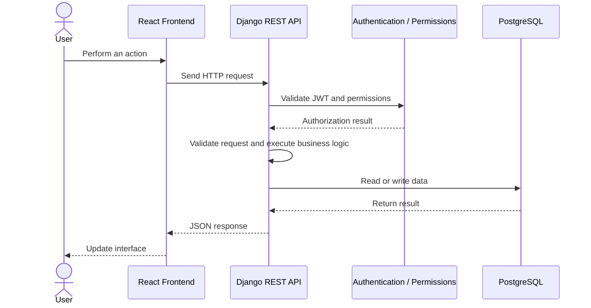

# Job Application Management System

## Architecture

Decoupled full-stack architecture.

Frontend:
- React
- JavaScript
- HTML5
- CSS3

Backend:
- Python
- Django
- Django REST Framework

Database:
- PostgreSQL

Authentication:
- JWT

Testing:
- Pytest
- Django Test Framework

Deployment:
- Frontend and backend hosted separately.

# CareerTrack — System Architecture

## 1. Architecture Overview

CareerTrack follows a three-tier architecture:

1. Presentation layer — React frontend.
2. Application layer — Django REST Framework backend.
3. Data layer — PostgreSQL database and persistent resume storage.

## 2. Request Lifecycle

## 3. Backend Responsibilities

- Authentication and user management.
- Request validation and serialization.
- Application and company management.
- Status transition enforcement.
- Dashboard and analytics calculations.
- Resume upload validation and storage integration.
- Notification generation.
- Database access through Django ORM.

## 4. Frontend Responsibilities

- User authentication and session handling.
- Protected routes.
- Dashboard and analytics visualization.
- Application CRUD workflows.
- Search, filters, sorting, and pagination.
- Kanban status management.
- Resume and profile management.
- Notification display.

## 5. Data Layer

PostgreSQL stores the application's relational data.

Main domain models:

- User
- Company
- JobApplication
- ApplicationStatusHistory
- ApplicationNote
- Interview
- ResumeDocument
- ApplicationNotification

Resume files are stored through the configured persistent storage integration rather than relying on temporary application filesystem storage.

## 6. Production Deployment

- React frontend: Render
- Django backend: Render
- PostgreSQL: Neon
- Resume storage: Configured external persistent storage

Production configuration is managed through environment variables.

## 7. Security Boundaries

- JWT authentication protects private API operations.
- Permission checks restrict access to authorized operations.
- User-scoped queries prevent users from accessing other users' application records.
- Serializer and model validation protect data integrity.
- Upload validation checks permitted document types and file signatures.
- Production deployment uses HTTPS and environment-based secrets.
